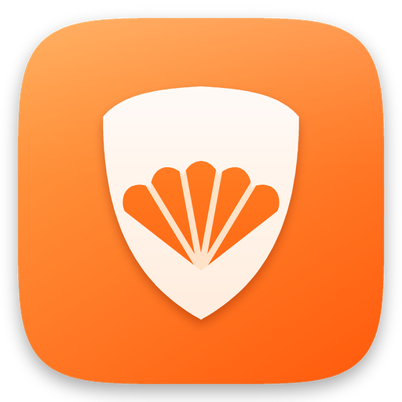
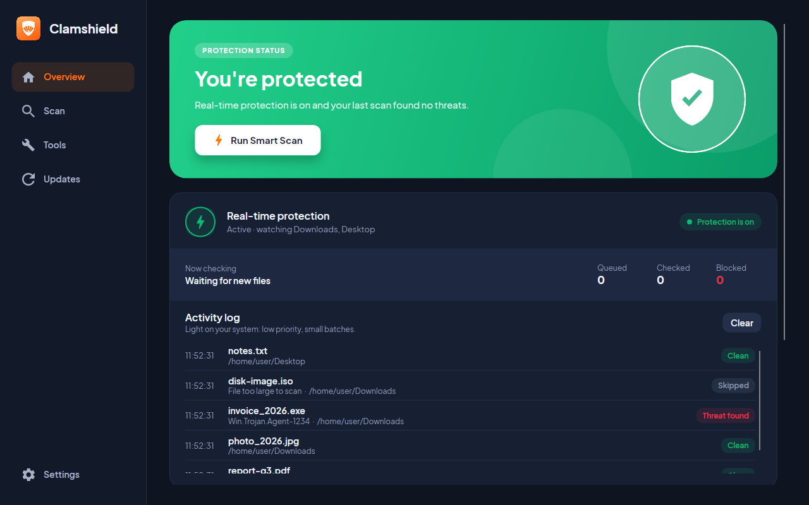
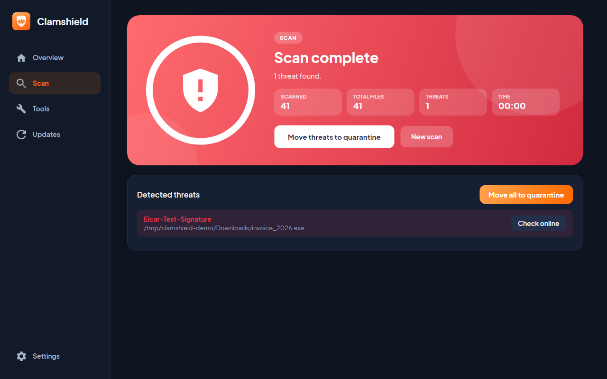
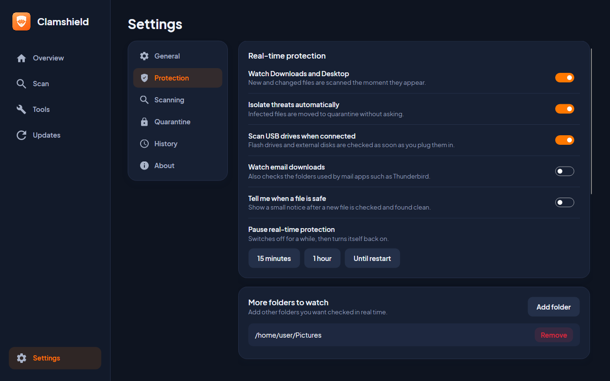
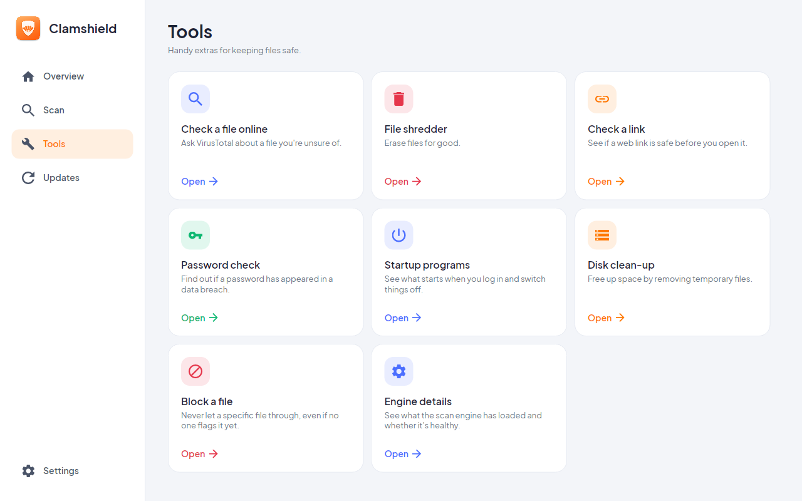
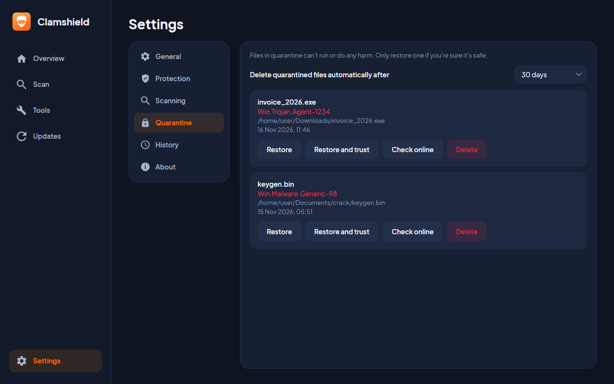
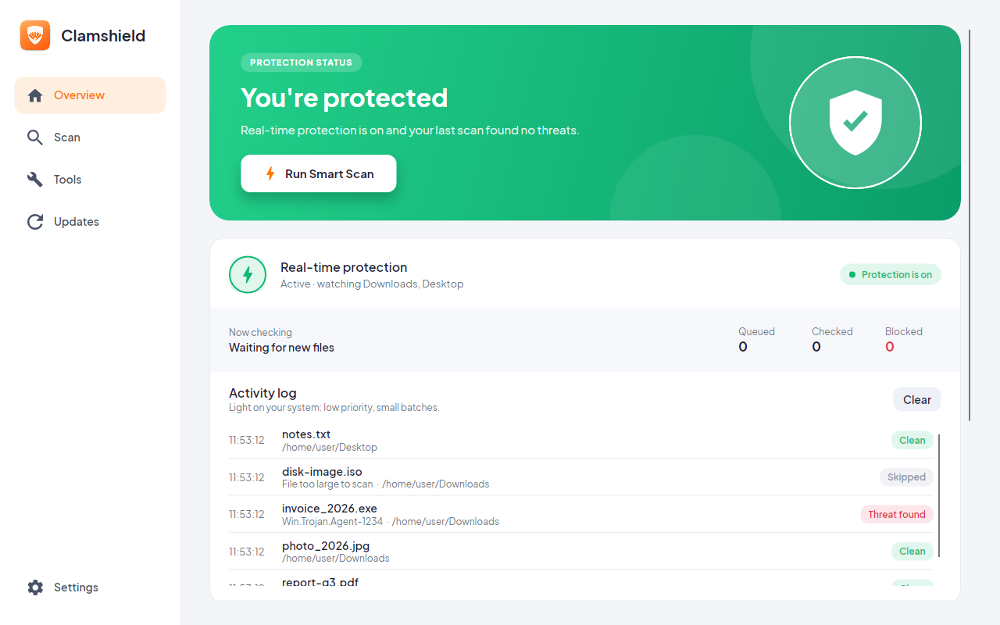
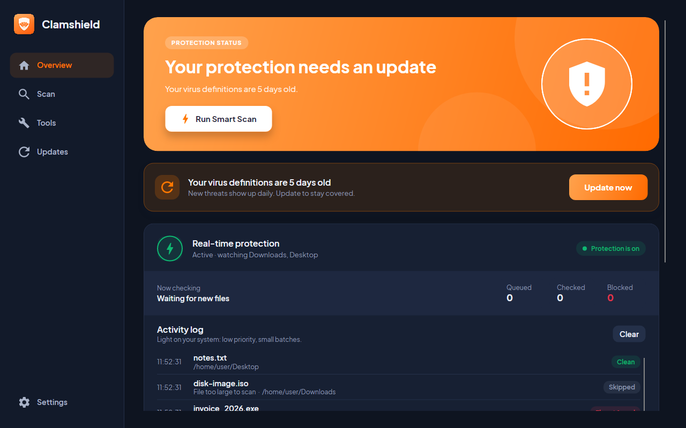

<p align="center">
  
</p>

<h1 align="center">Clamshield</h1>

<p align="center">
  A desktop antivirus that puts a friendly face on ClamAV.<br>
  Windows, macOS and Linux.
</p>

<p align="center">
  <a href="https://github.com/sansob/clamshield/actions/workflows/ci.yml"></a>
  <a href="https://github.com/sansob/clamshield/releases/latest"></a>
  <a href="LICENSE"></a>
  
</p>

<p align="center">
  
</p>

ClamAV is a solid open source antivirus engine, but on the desktop it comes as a handful of command line tools and config files. Clamshield wraps it in an app you can open, click through and forget about: a setup wizard, a dashboard, real-time protection, a tray icon and scheduled scans.

The scanning is done by ClamAV itself. Clamshield only starts it, reads what it says and shows you the result. It is an independent project and is not made or endorsed by the ClamAV team.

## What you get

### Protection
- Real-time protection for Downloads and Desktop, plus any folders you add. New and changed files are scanned in small, low-priority batches so the computer stays responsive.
- Quick, full and custom scans, drag and drop, a scan of the programs that are running right now, and saved profiles for folders you check often.
- USB drives are scanned when you plug them in.
- A warning when lots of documents change at once (a typical ransomware sign) and when a startup entry, scheduled job or SSH key changes.
- Scheduled scans that wait while you are on battery or running a full-screen app.

### Detection you can shape
- Strict mode for adware, risky Office macros and password-protected archives.
- Your own block list: block a file by its fingerprint and every copy of it is flagged, even if it has been renamed.
- YARA rules, validated by the engine before they are installed.
- Optional community signature lists, and a trusted-files list for false alarms.

### Tools
- Check a file or a link on VirusTotal. Only fingerprints are sent.
- Check whether a password appears in known breaches. The password never leaves your computer.
- File shredder, startup program manager, disk clean-up and an engine details page.

### Everyday use
- A first-run wizard that installs ClamAV if it is missing and downloads the virus definitions.
- A dashboard with a health score, a seven-day summary, a live activity log, and a notice when the definitions are out of date.
- Quarantine, scan history, HTML reports, a weekly summary, light and dark themes, English and Bahasa Indonesia.
- A command line mode for scripts.

The full list, with how each thing works, is in [docs/FEATURES.md](docs/FEATURES.md).

## Screenshots

| | |
|---|---|
|  |  |
|  |  |
|  |  |

More are in [docs/screenshots](docs/screenshots).

## Install

Download the file for your system from the [latest release](https://github.com/sansob/clamshield/releases/latest).

| System | File |
|---|---|
| Windows | `Clamshield-<version>-win-x64.zip` (or `win-arm64`) |
| macOS | `Clamshield-<version>-osx-arm64.dmg` for Apple silicon, `osx-x64` for Intel |
| Linux | `Clamshield-<version>-linux-x64.tar.gz` (or `linux-arm64`) |

Nothing else needs to be installed. On first start the setup wizard looks for ClamAV and installs it if it is not there. On Linux that asks for your administrator password once.

The builds are not code-signed yet, so Windows and macOS will warn you the first time you open them. [docs/INSTALL.md](docs/INSTALL.md) explains what to click and why.

## Command line

The same program doubles as a command line scanner:

```sh
clamshield --cli --quick                  # Downloads, Desktop, Documents
clamshield --cli --scan ~/Projects --json # one folder, machine-readable output
clamshield --cli --running                # the programs that are running now
```

The exit code is 0 when nothing was found, 1 when something was, and 2 on an error.

## Where things stand

Clamshield is developed and tested on Linux. The Windows and macOS builds are produced and tested by CI on every change, but the code that touches the operating system (the registry, launch agents, the right-click menu, the installers) has had very little real use. Expect rough edges there and please report them.

It is a signature-based scanner. It finds what ClamAV's databases describe. It does not watch what programs do, so it is not a replacement for a full endpoint security product.

There is no automatic update for Clamshield itself yet. Virus definitions do update on their own.

## Build from source

You need the [.NET 10 SDK](https://dotnet.microsoft.com/download). ClamAV is optional for building and testing, but you need it to scan.

```sh
git clone https://github.com/sansob/clamshield.git
cd clamshield
dotnet run --project src/Clamshield
dotnet test
```

[docs/DEVELOPMENT.md](docs/DEVELOPMENT.md) covers running against a throwaway data folder, regenerating the screenshots and adding a feature.

## Project layout

```
src/Clamshield/          the app (Avalonia UI, view models, services)
tests/Clamshield.Tests/  unit tests
docs/                    guides and screenshots
scripts/                 packaging and screenshot scripts
.github/workflows/       CI and release pipelines
```

## Contributing

Anyone can help, and there is plenty to do: testing on Windows and macOS, more languages, packaging for more systems, and bug fixes. Start with [CONTRIBUTING.md](CONTRIBUTING.md). Work happens on the `dev` branch, and merging `dev` into `main` publishes a release. [docs/RELEASING.md](docs/RELEASING.md) has the details.

## Documentation

| | |
|---|---|
| [docs/INSTALL.md](docs/INSTALL.md) | Installing, updating and removing |
| [docs/FEATURES.md](docs/FEATURES.md) | Every feature and how it works |
| [docs/ARCHITECTURE.md](docs/ARCHITECTURE.md) | How the code is organised |
| [docs/DEVELOPMENT.md](docs/DEVELOPMENT.md) | Building, testing and debugging |
| [docs/TRANSLATING.md](docs/TRANSLATING.md) | Adding or fixing a translation |
| [docs/RELEASING.md](docs/RELEASING.md) | Branches and the release pipeline |
| [docs/PRIVACY.md](docs/PRIVACY.md) | What leaves your computer, and what does not |
| [SECURITY.md](SECURITY.md) | Reporting a vulnerability |

## Credits and license

Clamshield is released under the [MIT license](LICENSE).

It relies on [ClamAV](https://www.clamav.net/) for scanning, [Avalonia](https://avaloniaui.net/) for the interface and the [Plus Jakarta Sans](https://github.com/tokotype/PlusJakartaSans) font. Optional features talk to [VirusTotal](https://www.virustotal.com/), [Have I Been Pwned](https://haveibeenpwned.com/Passwords) and the [Sanesecurity](https://sanesecurity.com/) signature mirrors. Licenses and details are in [THIRD_PARTY_NOTICES.md](THIRD_PARTY_NOTICES.md).
